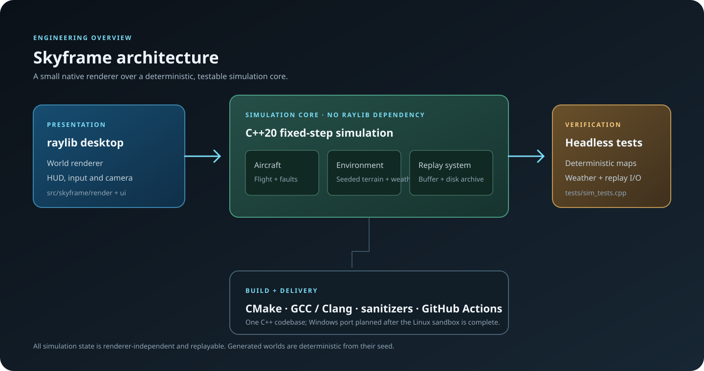
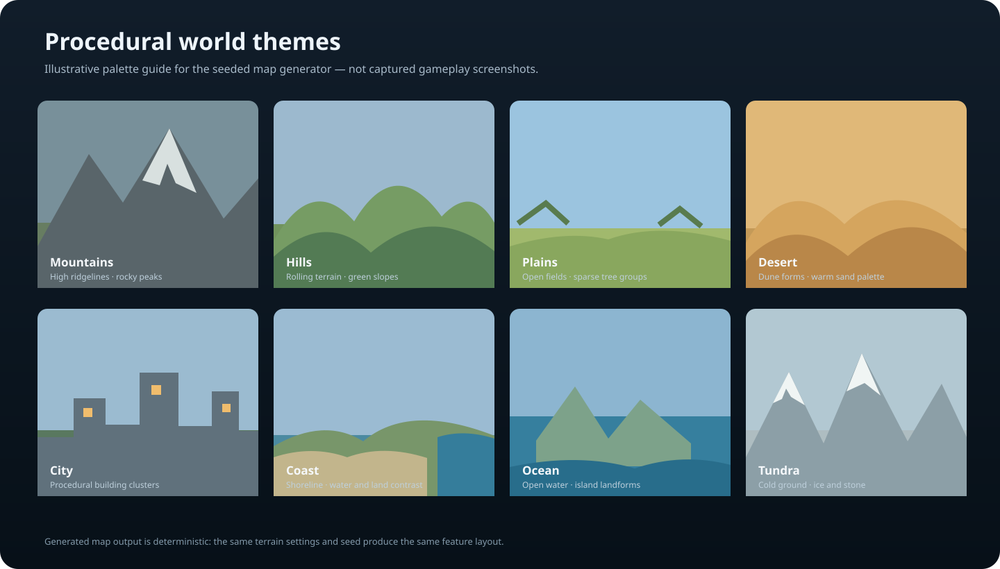
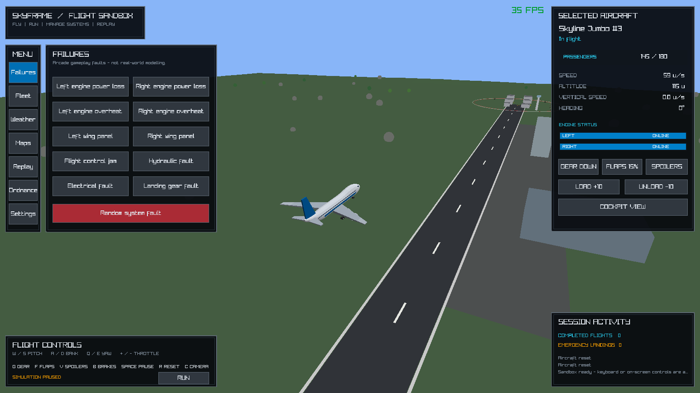
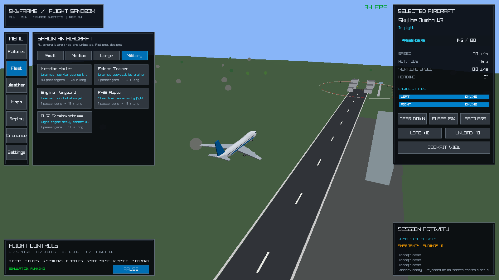
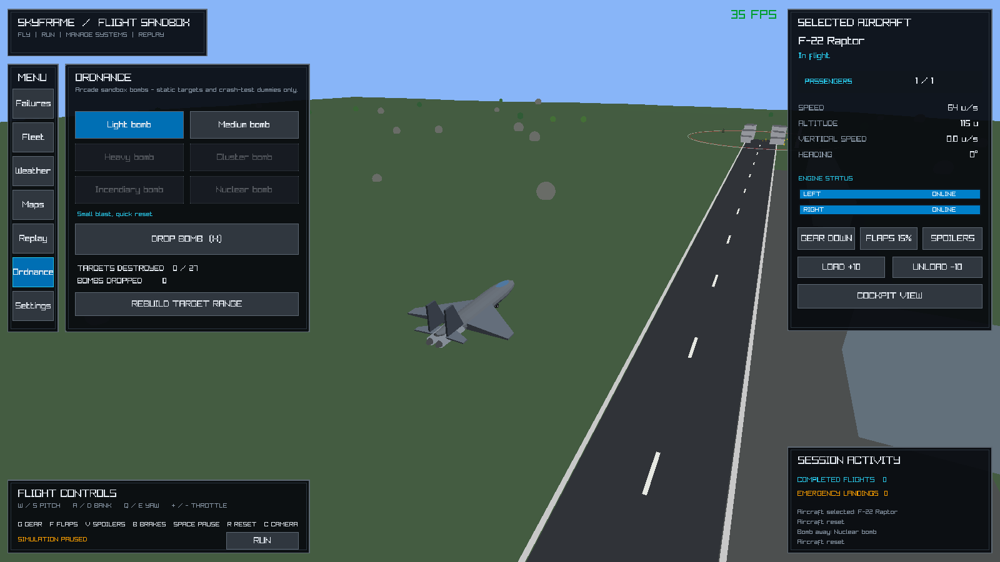
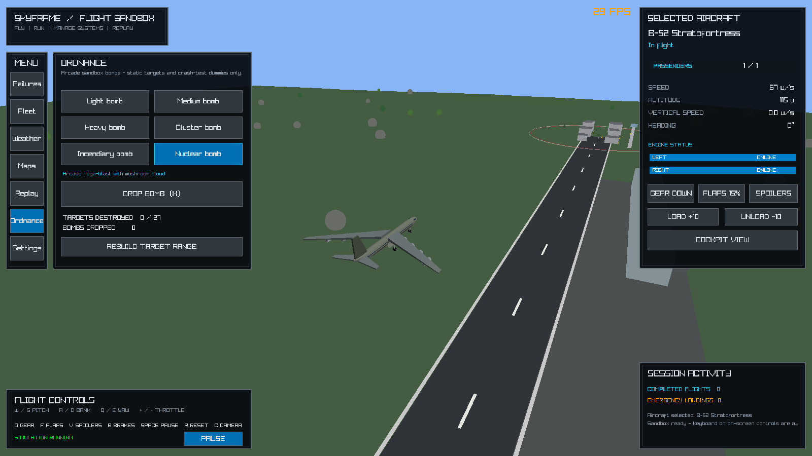
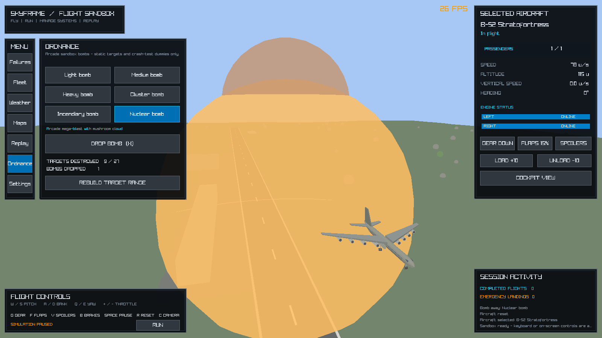
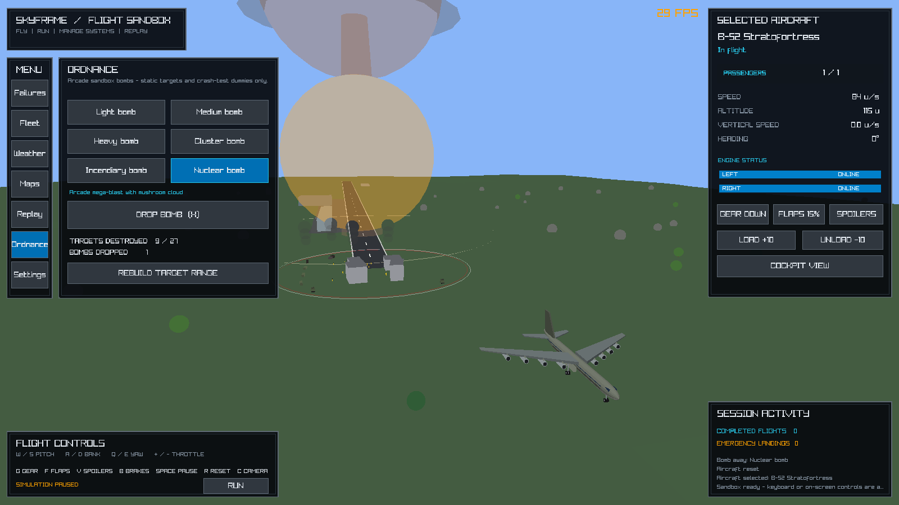

# Skyframe

Skyframe is a lightweight, native 3D aircraft sandbox built with **C++20, CMake and raylib**. It takes inspiration from a Roblox plane sandbox: choose an aircraft, configure a world, fly manually or let the simulation run, trigger fictional system failures, and review a replay.

Everything is free and unlocked. The project is local-first and designed around a low-memory Linux laptop with integrated graphics. Military aircraft can drop arcade sandbox bombs on static targets and crash-test dummies; nothing involves real people or places. Skyframe is an arcade sandbox, not a flight trainer or a real-world crash simulator.

## Visual overview

The first two images document the actual architecture and the world-generation design. They are diagrams, not fake in-game screenshots.

<p align="center">
  
</p>

<p align="center">
  
</p>

### In-game screenshots

These are real captures of the current desktop executable (raylib 5.5, OpenGL 4.5, Mesa llvmpipe **software rendering** under Xvfb, so frame rates are not representative of target hardware). Capture details are in [`docs/screenshots/README.md`](docs/screenshots/README.md).

| | |
|---|---|
| <br>Default scene, 1600×900. | <br>Fleet > Military with the F-22 Raptor and B-52 Stratofortress. |
| <br>F-22: light/medium bombs only, heavier types locked. | <br>B-52: all six bomb types. |
| <br>Arcade nuclear blast, seen with the look-back camera (`L`). | <br>Arcade mushroom cloud rising over the field. |

Also captured: 1280×720 (`01-`), 1920×1080 (`03-`) and the 1024×720 minimum layout (`10-`).

## Current features

### Aircraft sandbox

- 20 free, unlocked aircraft across Small, Medium, Large and Military categories, including an F-22-style stealth fighter and a B-52-style eight-engine bomber.
- Procedural low-poly aircraft models with distinct fuselage, wing, tail, engine and landing-gear layouts.
- Arcade flight model with pitch, bank, yaw, throttle, five flap detents, spoilers, landing gear and parking brake.
- Fictional system faults: engine power loss/overheat, wing-panel damage, flight-control jam, hydraulic/electrical faults and landing-gear faults.
- Passenger loading, cockpit warnings and a flight/evacuation report.

### Ordnance sandbox

- Arcade bombs for the **F-22 Raptor** (Light and Medium) and **B-52 Stratofortress** (Light, Medium, Heavy, Cluster, Incendiary, Nuclear). Other aircraft have no bay.
- Simple ballistics (gravity plus drag; bombs inherit the aircraft's velocity), blast radii, cluster bomblets, and an arcade nuclear blast with flash, fireball, stem and mushroom cap. It is a visual game effect only: no fallout, radiation or real-world weapon modelling.
- A deterministic, seeded **target range** of static buildings, a tower, trucks, inert anti-air gun vehicles and crash-test dummies that are flung by blasts. Nothing moves, aims or fires back.
- Ordnance panel with bomb selection, drop, target counter and range rebuild. Bounded storage (160 bombs, 48 blasts). Bombs are not part of replays yet.

### World generation

- Ten terrain themes: Training Field, Coast, Highlands, Desert, Hills, Plains, City, Ocean, Tundra and Mountains, plus a **Random** terrain selector that chooses one of those themes from the map seed.
- Small, Medium and Large map sizes.
- New sessions start in Random terrain mode. Deterministic random generation means the same terrain mode, settings and seed reproduce the same biome selection, height field, scenery placement and airport layout. Use **New Random Seed** to roll a fresh world; keep the seed to revisit it later.
- Optional airport generation with By Map, Random, International, Regional, Military and Airfield types.
- Independent world toggles for towers, power lines and natural terrain scenery; the airport has its own on/off toggle.
- A cached 33×33 height field (32×32 cells) creates 2,048 low-poly terrain triangles per map; terrain noise is generated once when the map configuration changes, not every frame.
- The runway corridor and airport pad are flattened into the generated height field; terrain props are placed against the same height profile.

### Weather and time of day

- Auto, Clear, Cloudy, Rain, Storm, Fog, Snow and Windy presets.
- Wind direction, gusts, turbulence, visibility, cloud base, rain, snow, fog and lightning atmosphere values.
- Auto weather transitions through a deterministic sequence during an active session.
- Morning, Day, Evening, Night and Cycle lighting modes.
- Weather and time-of-day state are included in replay frames.

### Replays

- Automatic rolling replay buffer with bounded memory and interpolated playback.
- Save recordings locally in a versioned, text-based `.sfr` format.
- List, load, rename and delete saved recordings from the Replay panel; the UI paginates the 30-entry archive and captures keyboard input while renaming.
- Saved recordings preserve aircraft state, map settings and seed, weather, and time of day.
- Replay format version 2 stores the separate tower, power-line and scenery switches, while retaining support for older version 1 recordings.
- Archive protections include frame/file limits, finite-number validation, path traversal rejection and temporary-file replacement.

## Hardware and design targets

The main target is Fedora Linux on a Ryzen 5-class APU with Radeon 610M integrated graphics and approximately 5.6 GiB usable RAM. The normal target is 1920×1080 at 60 FPS, but real-device frame rate still needs to be measured.

The implementation deliberately avoids a heavyweight game engine, a second implementation language, a general-purpose ECS, and an external physics engine. The renderer is kept separate from the deterministic simulation core.

## Build requirements

- CMake 3.20 or newer
- Ninja
- C++20 compiler (GCC 14+ or Clang 17+ tested in the current environment)
- raylib 5.x development package for the graphical application

On Fedora, install the tools and raylib development files:

```sh
sudo dnf install gcc-c++ cmake ninja-build raylib-devel
```

Build and test the simulation core without a graphics dependency:

```sh
cmake --preset core-release
cmake --build --preset core-release
ctest --preset core-release
```

Run the AddressSanitizer + UndefinedBehaviorSanitizer configuration:

```sh
cmake --preset core-sanitize
cmake --build --preset core-sanitize
ctest --preset core-sanitize
```

Build the desktop app (requires raylib):

```sh
cmake --preset desktop-release
cmake --build --preset desktop-release
ctest --test-dir out/desktop-release --output-on-failure
./out/desktop-release/skyframe
```

The checked-in presets use Ninja and limit parallelism to two jobs for the low-memory target. If raylib is not found, CMake warns and still builds the simulation library and tests; that fallback does **not** produce the desktop game.

## Controls

| Input | Action |
|---|---|
| `W` / `S` | Pitch |
| `A` / `D` | Bank |
| `Q` / `E` | Yaw |
| `+` / `-` | Throttle |
| `G` | Landing gear |
| `F` | Cycle flap setting |
| `B` | Parking brake |
| `V` | Spoilers |
| `Space` | Pause / resume |
| `R` | Reset flight |
| `C` | Chase / cockpit camera |
| `X` | Drop selected bomb (ordnance-capable aircraft) |
| `Z` / `Shift+Z` | Next / previous bomb type |
| `L` (hold) | Look-back camera: watch your blasts |
| `P` / `O` | Start / stop rolling replay |
| `Esc` | Quit |

The left navigation opens Failures, Fleet, Weather, Maps, Replay and Settings. The right panel contains telemetry, passenger controls and aircraft controls.

## Local replay storage

Saved replays are stored outside the repository in the user's application-data directory:

- Linux: `${XDG_DATA_HOME:-~/.local/share}/skyframe/replays`
- Windows: `%APPDATA%\Skyframe\replays` (planned portability path; Windows runtime is not yet verified)

The `.sfr` format has a versioned header and validates frame count, timestamps, enum values, finite numeric state and file size before accepting a recording.

## Repository layout

```text
.github/                         GitHub Actions and issue / PR templates
assets/                          Asset and licensing notes
docs/
  images/                        README diagrams
  screenshots/                   Screenshot policy; add verified in-game captures here
  ARCHITECTURE.md                Module boundaries and design decisions
  CLAUDE_HANDOFF.md              Detailed engineering status and next tasks
  DEVELOPMENT_LOG.md             Dated record of every engineering pass
  PERFORMANCE.md                 Hardware and profiling constraints
  PROJECT_STATUS.md              Verified versus unverified status
  ROADMAP.md                     Tracked public roadmap
src/skyframe/core/               Math primitives
src/skyframe/sim/                Renderer-independent flight/world/replay simulation
src/skyframe/render/             raylib 3D renderer and aircraft models
src/skyframe/ui/                 HUD and sandbox panels
tests/                           Headless deterministic regression tests

CLAUDE.md                         Persistent Claude Code project instructions
CLAUDE_PROMPT.md                  Reusable continuation prompt
```

## Project guidance

- [Project status](docs/PROJECT_STATUS.md)
- [Roadmap](docs/ROADMAP.md)
- [Architecture](docs/ARCHITECTURE.md)
- [Performance targets](docs/PERFORMANCE.md)
- [Engineering log](docs/DEVELOPMENT_LOG.md)
- [Claude handoff](docs/CLAUDE_HANDOFF.md)
- [GitHub setup](docs/GITHUB_SETUP.md)

`CLAUDE.md` is the canonical instruction file for Claude Code. Preserve it and the project documentation. Keep the README image gallery updated with verified executable screenshots; do not claim mockups or diagrams are gameplay captures.

## Future Windows version

A Windows desktop version is planned **after the Linux offline sandbox is complete and stable**. The intention is to port this same C++20/raylib codebase, not create a parallel engine. Windows-specific work will include MSVC builds, CI, packaging, controls verification and user-data/replay-path testing. It is deliberately not the current milestone.

## Non-goals

- No DLC, game passes or paid content.
- No realistic weapon modelling, real-world targeting or operational attack procedures. Ordnance is arcade gameplay against static props and crash-test dummies only.
- No real-world crash reconstruction or aviation-training claims.
- No online account/server requirement for the local sandbox.
- No multi-language engine split or heavyweight engine replacement without measured evidence and owner approval.

## License

MIT. See [`LICENSE`](LICENSE).
