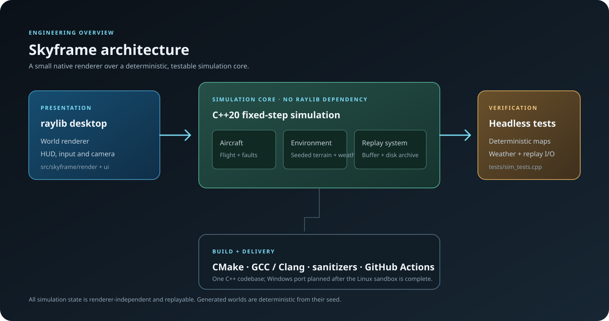

# Skyframe architecture

## Overview

Skyframe is a C++20 desktop sandbox with a thin raylib presentation layer and a headless simulation library. The separation is intentional: deterministic world generation, flight state, weather and replay persistence can be built and tested without a graphics context.

## Modules

### `src/skyframe/core/`

Small vector/quaternion math and shared numeric helpers. It has no dependency on raylib or the operating system.

### `src/skyframe/sim/`

- `aircraft.*`: arcade flight handling, controls, fictional system failures, telemetry, passenger manifest and flight report.
- `fleet.*`: free, unlocked aircraft presets plus procedural design parameters.
- `environment.*`: weather state, time-of-day state, map configuration, deterministic terrain feature generation, cached height-field generation and airport selection.
- `replay.*`: rolling bounded capture, interpolation, playback and frame replacement after a validated load.
- `replay_archive.*`: versioned local replay serialization, list/load/rename/delete, safe filenames and bounded archive input.
- `simulation.*`: 120 Hz fixed-step update, session state, environment updates, events and capture coordination.

The simulation core must not include raylib headers. Any new gameplay rules, save formats or state transitions belong here and should have deterministic tests.

### `src/skyframe/render/`

- `aircraft_model.*`: procedural low-poly models generated from `AircraftDesign` values.
- `world.*`: raylib camera, terrain rendering, runway/apron/hangars, weather particles/fog and time-of-day sky colors.

The world renderer caches `GeneratedMap` and regenerates it only when `MapConfig` changes. Avoid per-frame terrain allocation. Keep culling bounds and draw counts conservative for Radeon 610M-class integrated graphics.

### `src/skyframe/ui/`

`hud.*` provides the fleet, failures, weather, map, replay and settings panels. The replay screen calls `ReplayArchive` for local persistence. UI code can depend on raylib; the simulation cannot.

### `tests/`

`sim_tests.cpp` exercises the core headlessly, including deterministic map generation, weather transitions, time-of-day cycling, replay interpolation, persistence round trips, validation, aircraft flight and regression behavior.

## Simulation timing

The simulation uses a fixed 1/120-second step with bounded catch-up. Frame time is clamped before accumulation. Weather auto-rotation and time-of-day cycling advance on simulation time, so pause/replay does not accidentally change the active session's world state.

## World generation

`MapConfig` is the complete input to `generateMap`: terrain mode, size, seed, airport enabled/type, and independent towers, power-lines and natural-scenery switches. The Random terrain mode deterministically selects one of the ten concrete biomes from the seed; the selected biome is stored as `GeneratedMap::resolvedTerrain` for rendering and UI display. A deterministic xorshift generator produces stable height fields, feature layouts and airport selection. The result includes generated features, runway/airport configuration, extent and a fingerprint used by tests. Identical configs must generate identical output.

The world generator produces a bounded 33×33 height field (32×32 cells) for each `GeneratedMap`. It uses deterministic seeded terrain profiles and noise, then flattens the runway corridor for a level airport pad. The renderer draws two low-poly triangles per cell (2,048 triangles per map) from the cached samples. Terrain noise is not evaluated per rendered frame. This is a small height-field mesh, not a voxel or large-scale streaming-terrain engine; map detail remains intentionally bounded for integrated graphics.

## Weather and time

`WeatherState` separates the requested preset from its currently active preset so Auto can cycle through deterministic weather phases. Continuous values (wind, gust strength, visibility, cloud base, precipitation, fog and lightning) are stored in replay frames. `TimeOfDayState` supports Morning, Day, Evening, Night and Cycle. These states remain simple value objects and contain no renderer types.

## Replay recording and persistence

`ReplayRecorder` stores a bounded rolling history. Frame interpolation blends continuous aircraft/weather values while discrete map and weather choices come from the nearest surrounding frame.

`ReplayArchive` uses a versioned, human-readable `.sfr` file. Version 2 stores the independent world-feature switches; version 1 is still accepted and its combined infrastructure flag maps to both towers and power lines. The parser has explicit limits for file bytes and frame count, validates enum bounds, timestamps and finite numeric values, and rejects unsafe path components. Writes are prepared in a temporary file before replacement. The default directory is under the user's application data area, never inside the source repository.

The saved frame contains aircraft snapshot, aircraft preset index, map configuration (including seed), weather state and time-of-day state. New fields require a format-version increment or a documented compatibility migration.

## Portability

Keep shared modules standard C++20. Use `std::filesystem` and small platform-specific path helpers rather than POSIX-only file operations. The eventual Windows port should reuse the same source/build model; it is deferred until the Linux offline sandbox is complete and verified.

## Performance constraints

- Low-poly procedural models and environment features.
- No real-time shadow map requirement.
- Bounded replay frame count and saved replay count.
- Generate terrain only when map settings change.
- No per-frame filesystem scans; the HUD refreshes the saved replay list only on startup and after archive actions.
- Two build jobs on the target low-memory system.

See [PERFORMANCE.md](PERFORMANCE.md) and [PROJECT_STATUS.md](PROJECT_STATUS.md) for current measurements and unverified items.
